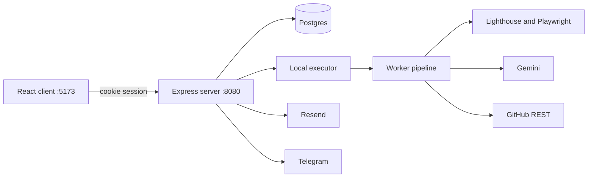

# PerfPilot AI

PerfPilot is an autonomous web performance engineer for a frontend or DevOps workflow. It measures a page, diagnoses it, applies one fix at a time, keeps the fix only when the gates prove an improvement, reverts the rest, opens a pull request, then keeps watching the URL and alerts when a regression holds.

## What it does

- Audits a URL with Lighthouse (mobile, simulated throttling) and a fix plan.
- Optimizes a GitHub repo in a sandbox: build, smoke, visual, and performance gates, then a pull request when at least one fix is kept. It never merges.
- Runs URL-only experiments through a local rewrite proxy and the same performance judgment. Nothing is committed.
- Fetches PageSpeed Insights (mobile) and Chrome UX Report (phone) field data when `GOOGLE_API_KEY` is set. A missing key is stored as a note and the job still succeeds.
- Monitors a URL on a cron schedule or on demand, charts the trend, and sends email and Telegram.
- Can dispatch the same job to GitHub Actions when `EXECUTOR=github`. That executor is implemented and unit-tested, not yet run end to end on GitHub-hosted runners. The default executor is a local child process.

## Architecture



The client talks only to the server. Vite proxies `/api` to port 8080. With `EXECUTOR=github`, the server dispatches `.github/workflows/perfpilot-job.yml` and the runner posts events to `/api/internal/jobs/:id/events`. That path is implemented and unit-tested, not yet run end to end on GitHub-hosted runners.

## Quickstart

Prerequisites: Node.js 20.6 or newer, Git, a Neon (or any) Postgres database, and the keys in `.env.example`.

Windows (PowerShell) and macOS/Linux use the same commands. Run each line on its own.

```
git clone <your-repo-url>
cd perfpilot_ai
npm install
npx playwright install chromium
copy .env.example .env
```

On macOS/Linux, use `cp .env.example .env` instead of `copy`. Fill in `.env`. Never commit it.

```
npm run db:migrate --workspace server
npm run seed --workspace server
npm start --workspace demo-site
npm run dev
```

Open http://localhost:5173. The demo site listens on http://localhost:4200. Sign in with `ADMIN_PASSWORD`.

## Environment variables

Names only. Blank means unset. Defaults are what the code uses when the variable is empty.

| Name | Purpose | Required | Default |
| --- | --- | --- | --- |
| `GEMINI_API_KEY` | Gemini planning and AI edits | yes, to start the server | |
| `GEMINI_MODEL` | Model id, `models/` prefix stripped | yes, to start the server | |
| `GOOGLE_API_KEY` | PageSpeed Insights and CrUX | optional | skip field fetch |
| `GITHUB_TOKEN` | Clone, push, pull request | yes, to start the server | |
| `GITHUB_OWNER`, `GITHUB_REPO` | Actions target; also fill the demo repo when `DEMO_REPO_*` is empty | optional | demo repo values |
| `DEMO_REPO_OWNER`, `DEMO_REPO_NAME` | Seeded repo project | yes, to start the server | `GITHUB_OWNER` / `GITHUB_REPO` |
| `DATABASE_URL` | Postgres | yes | |
| `SESSION_SECRET` | Signs the `pp_session` cookie | yes | |
| `ADMIN_PASSWORD` | Single shared login | yes | |
| `JOB_SECRET` | `x-job-secret` for internal routes | optional | empty rejects those routes |
| `CLIENT_ORIGIN` | CORS origin and links in notifications | yes | |
| `COOKIE_SAMESITE` | `lax` or `none` | optional | `lax` |
| `RESEND_API_KEY`, `EMAIL_FROM` | Email | optional | email skipped |
| `NOTIFY_EMAIL_DEFAULT` | Fallback address | optional | |
| `TELEGRAM_BOT_TOKEN`, `TELEGRAM_CHAT_ID` | Telegram | optional | Telegram skipped |
| `NOTIFY_DRY_RUN` | `1` records a dry run and does not send | optional | send for real |
| `MONITOR_MIN_HISTORY` | Healthy checks before monitoring compares | optional | `3` |
| `SCHEDULER_ENABLED` | `0` disables cron | optional | enabled |
| `DIGEST_CRON` | Weekly email digest | optional | `0 8 * * 1` |
| `EXECUTOR` | `github` uses Actions; anything else is local | optional | local |
| `PERFPILOT_URL` | Public origin GitHub Actions calls back. A localhost URL is not reachable from a GitHub-hosted runner | optional | `CLIENT_ORIGIN` |
| `PERFPILOT_CHROME` | Chrome binary | optional | Playwright Chromium |
| `PORT` | API port | optional | `8080` |
| `NODE_ENV` | `production` sets a Secure cookie | optional | `development` |
| `DEMO_REGRESSION` | Demo site only. `1` injects `/regression.js` | optional | off |
| `SCREENSHOT_BASE`, `SCREENSHOT_FROM` | `scripts/screenshots.mjs` only | optional | `http://localhost:5173` |

## Commands

| Command | What it does |
| --- | --- |
| `npm run dev` | API and client together |
| `npm test` | Worker, server, then client tests |
| `npm run verify` | Tests, worker and server `tsc --noEmit`, client build, secret scan |
| `npm run db:migrate --workspace server` | Apply `server/migrations` |
| `npm run seed --workspace server` | Upsert the two demo projects |
| `npm start --workspace demo-site` | Slow demo site on port 4200 |
| `npm run check-env` | Live account check. It can send a Telegram message |
| `npm run demo:check` | Demo checklist. Does not send mail or Telegram |
| `npm run demo:reset -- --confirm` | Clear measurements and incidents for the named URL demo projects |
| `npx tsx --env-file=.env worker/src/cli.ts` | `measure`, `ab`, `compare`, `diagnose`, `optimize`, `report` |

`optimize` accepts `--runs` (3–25, gate default 4), `--final-runs` (default 5), `--max-steps`, `--only id,id`, and `--no-ai`. The CLI has no `experiment` or `field` command; those run from the UI and the job runner.

## How a repo-mode run works

1. The server stores a job as `queued` and the local executor starts one worker child. Stdin is the job spec. Stdout lines are events.
2. The worker clones `owner/repo` at `baseBranch` into `runs/<jobId>/src` and checks out a new branch. The token is an `http.extraheader`, then redacted from errors.
3. It measures a mobile baseline, runs Lighthouse once, and plans fixes with Gemini, or the built-in ranking when AI is off or the model call fails.
4. For each step, up to `maxSteps`: apply the fix, then build, smoke, visual, and performance. AI fixes get one repair attempt. A pass is committed in the sandbox. A failure is `git reset --hard`.
5. A final interleaved comparison is recorded. If any step was kept, the branch is pushed and a pull request is opened. Otherwise nothing is pushed.
6. The server writes `report.pdf`, stores the result, and notifies. Notification failures do not fail the job.

`onlyFixes` limits the plan to those ids. An empty selection uses the plan.

## How monitoring works

A project with `scheduleCron` gets a monitor job (5 runs) from the in-process scheduler. The project page can also start one with **Run check now**. The first checks stay `learning` until `MONITOR_MIN_HISTORY` earlier `ok` or `learning` checks exist (default 3). Later checks are compared with the last three `ok` checks, pooled. If there are fewer than three `ok` checks, the pool is the last three `ok` or `learning` checks. Two harmful breaches in a row open one incident and send one alert. Further bad checks update that incident and do not alert again. The next healthy check closes it and sends a recovery message. A URL project has no suspect commits. A repo project asks GitHub for commits since the last healthy check.

`DEMO_REGRESSION=1` makes the demo site inject `/regression.js` into HTML so a later check can regress. Restart the demo site after changing it.

## Free tier map

Provider limits as of October 2026. This repo does not enforce them.

| Service | Used for | Limit that matters |
| --- | --- | --- |
| Neon Postgres | Projects, jobs, measurements | Free plan: 100 CU-hours per project per month, and 1 GB storage per project. Compute scales to zero after idle time. |
| Gemini API | Plans and file edits | Free-tier requests per minute, tokens per minute, and requests per day depend on the model. Read them in AI Studio. |
| GitHub | Clone, pull request, optional Actions | Public repos: standard hosted runner minutes are free. Private free accounts: 2,000 Linux minutes per month. |
| Resend | Alert, recovery, and digest email | Free accounts: 100 transactional emails per day and 3,000 per month. |
| Telegram Bot API | The same alerts | No fee. Flood control applies if messages are sent too fast. |
| PageSpeed Insights and CrUX | Field card | The Google Cloud quota on that key. |

## Security

- Secrets are not stored in job rows. Log lines and Git errors pass through a redactor. The Gemini key is an HTTP header, not a query parameter. Field notes replace `key=` values.
- Login is one shared password, compared by SHA-256 digest with `timingSafeEqual`. The session cookie is `pp_session`, HttpOnly, 12 hours, HMAC-signed. Five failures per IP lock login for 15 minutes.
- Internal routes (`/api/internal/run-due`, job spec, job events) require `x-job-secret`. An empty secret always returns 401.
- Report HTML is escaped. Prompts tell the model that page content, findings, and gate failures are untrusted data.
- GitHub is used to push a branch and open a pull request. There is no merge API call. The GitHub Actions executor is implemented and unit-tested, not yet run end to end on GitHub-hosted runners.
- The runtime proxy fetches with `redirect: manual`. A 3xx whose `Location` stays on the target origin is rewritten onto the proxy origin and returned to the browser, which follows it. Any other origin, a missing `Location`, or a chain past five hops returns `502` with the text `blocked redirect`, and the experiment result records that note. The proxy does not follow redirects itself.
- Project URLs and the field, experiment, and monitor worker entry points accept only `http:` and `https:`, reject credentials, and reject URLs longer than 2048 characters. Link-local addresses (`169.254.0.0/16`), `fd00:ec2::254`, and `metadata.google.internal` are always rejected. Private ranges (`10.0.0.0/8`, `172.16.0.0/12`, `192.168.0.0/16`), loopback, `::1`, and `fc00::/7` are rejected unless `ALLOW_PRIVATE_TARGETS=1` (the default when `NODE_ENV` is not `production`; the default in production is off). Hostnames are resolved with `dns.lookup` and every returned address is checked. A later change of that name (DNS rebinding) is not watched.
- `npm run verify` runs `scripts/scan-secrets.mjs` over tracked files (file and line only) and `git log -p` (counts only).

## Testing

`npm run verify` runs the workspace tests, `tsc --noEmit` for the worker and the server, the client production build, and the secret scan.

## Roadmap / not implemented

- **Hosted deployment.** Lighthouse and Chromium need more memory than typical free backend tiers provide, so the default executor runs the worker on the same machine as the API. There is no hosted production deploy in this repo.
- **Playwright request interception.** URL experiments rewrite responses in a local HTTP proxy (`worker/src/runtime/proxy.ts`). They do not use Playwright's request-interception API.

Details: [docs/ARCHITECTURE.md](docs/ARCHITECTURE.md), [docs/STATISTICS.md](docs/STATISTICS.md), [docs/API.md](docs/API.md), [docs/DEMO_SCRIPT.md](docs/DEMO_SCRIPT.md), [docs/SUBMISSION.md](docs/SUBMISSION.md).
