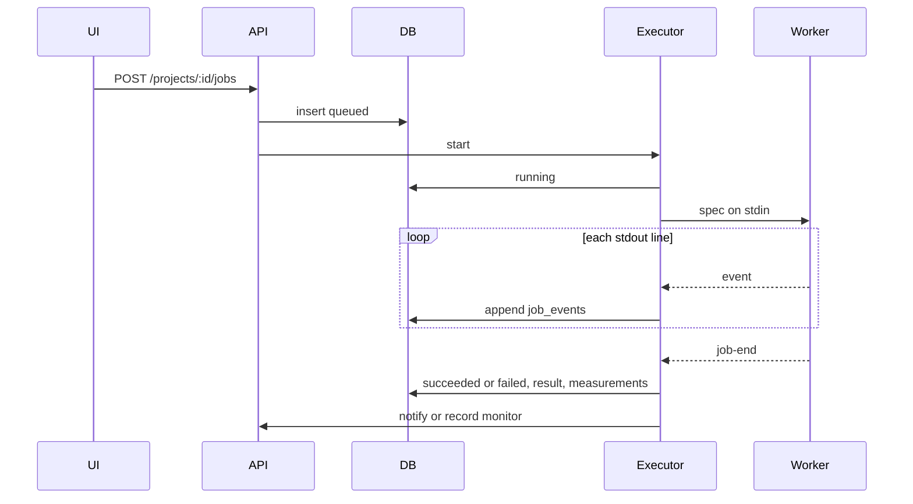
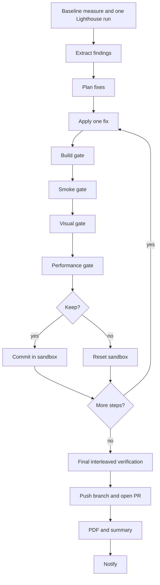

# Architecture

## Components

| Piece | Responsibility |
| --- | --- |
| `client` | React UI on port 5173. Vite proxies `/api` to the server. Session cookie, no tokens in the browser. |
| `server` | Express API, Postgres, one local worker at a time, optional GitHub Actions executor, cron scheduler, email and Telegram. |
| Postgres | Projects, jobs, events, measurements, incidents, notifications, `schema_migrations`. |
| Local executor | Spawns `worker/src/job-runner.ts`, writes the spec on stdin, reads one JSON event per stdout line. Timeout 90 minutes. One child at a time; further jobs stay queued in memory and in the database. |
| GitHub Actions executor | Used only when `EXECUTOR` is exactly `github`. Dispatches `perfpilot-job.yml` and accepts callbacks on the internal routes. |
| Worker | Measure, diagnose, plan, apply, gate, runtime proxy, field fetch, PDF HTML. |
| Lighthouse / Playwright | One headless Chrome per run. Playwright also supplies the Chromium binary and the smoke/visual browser. |
| Gemini | Fix planning and the AI file edits. Heuristic ranking is the fallback. |
| GitHub REST | Clone, push `HEAD:refs/heads/<branch>`, `POST /repos/{owner}/{repo}/pulls`. |
| Resend / Telegram | Notifications after a job settles. A send failure is stored and does not change the job status. |

## Job lifecycle

Statuses: `queued`, `running`, `succeeded`, `failed`, `cancelled`.

Cancel of a queued local job marks it `cancelled` and emits `job-end`. Cancel of the running child kills the process tree. On startup, rows still `running` are marked `failed` with error `server restarted` and queued rows are started again. A child that exits without `job-end` is `failed` (nonzero) or `succeeded` (exit 0). The 90-minute timer fails the job with `timed out after 90 minutes`.

## Worker pipeline

Repo optimize:

A skipped fix (no applier, report-only, or "needs AI") does not run the gates. An AI fix that fails a gate is reset and tried once more with the failure text marked untrusted. The final comparison does not revert kept commits. A pull request is opened only when `kept` is at least one. The report is written either way.

URL experiment: one Lighthouse diagnosis, heuristic plan (no Gemini call; the runner passes an empty API key), then for each runtime-testable fix a local proxy. Each step is measured with `measureInterleaved`: the raw URL, then the proxy URL, repeated for the requested runs. The performance gate uses `judgePerformance`. A kept step is one the harm policy accepts. Repo-only fixes are skipped with reason `needs a repository`. There is no build, smoke, or visual gate and no pull request. The proxy listens on `127.0.0.1`, fetches only URLs whose origin matches the target, and returns 400 for anything else. Node's fetch follows redirects, so a same-origin URL that redirects elsewhere is still fetched. The proxy speaks plain HTTP to Lighthouse even when the target is HTTPS. It does not rewrite other origins.

Field job: `fetchField` only, then `job-end`. PageSpeed Insights is one mobile lab run. Chrome UX Report is phone data for the origin. Current CrUX records use `largest_contentful_paint` (not `largest_contentful_paint_ms`) and may send `p75` as a string. The field card shows the lab column beside the field column, with the p75 rating and the good / needs-improvement / poor densities. Audit also calls `fetchField` and attaches `field` when the call returns. A missing key, HTTP error, timeout, or JSON parse failure is stored as a note. The job still succeeds.

Monitor job: `measureUrl` only. The server, not the worker, scores it against history.

## Database

| Table | Columns that matter |
| --- | --- |
| `projects` | `id`, `name`, `mode` (`url` or `repo`), `url`, `repo_owner`, `repo_name`, `base_branch` default `main`, `root_dir`, `notify_email`, `telegram_chat_id`, `schedule_cron`, `created_at` |
| `jobs` | `id`, `project_id`, `type` (`audit`, `optimize`, `monitor`, `experiment`, `field`), `status`, `params` jsonb, `result` jsonb, `pr_url`, `error`, `created_at`, `started_at`, `finished_at` |
| `job_events` | `id`, `job_id`, `ts`, `type`, `payload` jsonb |
| `measurements` | `id`, `project_id`, `job_id`, `taken_at`, `profile`, `metrics`, `status` (`ok`, `learning`, `breach`, `regression`), `compared`, `samples`, `medians`, `field` |
| `incidents` | `id`, `project_id`, `opened_at`, `closed_at`, `first_measurement_id`, `last_measurement_id`, `alert_sent_at`, `recovery_sent_at`, `details` |
| `notifications` | `id`, `project_id`, `job_id`, `channel` (`email` or `telegram`), `kind`, `status` (`sent`, `failed`, `dry-run`), `error`, `created_at` |
| `schema_migrations` | `filename`, `applied_at` |

Chart queries drop rows whose `samples` are null, so a field row does not enter the trend.

## Event catalog

Stdout is `{"type","payload"}`. The payload keys below are what gets stored. Optimize and experiment forward the worker event object, so those payloads also contain `type`.

| type | payload keys |
| --- | --- |
| `job-start` | `jobId`, `type` (the job type) |
| `baseline` | `type`, `aggregate` (metric to `{median, n}` or null), `findingsCount` |
| `plan` | `type`, `source` (`gemini` or `heuristic`), `note`, `steps[]` of `order`, `fix`, `title`, `risk`, `rationale`, `expectedImpact` |
| `step-start` | `type`, `order`, `fix` |
| `gate-start` | `type`, `order`, `fix`, `gate` (`build`, `smoke`, `visual`, `performance`) |
| `gate-end` | `type`, `order`, `fix`, `gate`, `passed`, `details`, `ms`, and on the performance gate `comparison` (`verdict`, `metrics[]`) and `runsPerSide` |
| `step-end` | `type`, `order`, `fix`, `status`, `reason`, `attempts`, `metricsSummary` |
| `run-end` | `type`, `kept`, `reverted`, `skipped`, and for optimize also `errored` |
| `pr-created` | `url`, `number` |
| `report-ready` | `file` (`report.pdf`) |
| `log` | `line` (also used for redacted stderr) |
| `actions-run` | `runId` (Actions callback only) |
| `job-end` | `ok`, plus the fields for that job |

`job-end` extras:

- Audit: `baseline`, `findings`, `plan`, and `field` when the fetch returns.
- Optimize, pull request opened: `prUrl`, `summary`, `ledger`, `branch`.
- Optimize, nothing kept: `prUrl` null, `reason`, `summary`, `ledger`.
- Experiment: `baseline`, `findings`, `plan`, `ledger`, `experiments`.
- Field: `field`.
- Monitor: `measurement` with `profile`, `samples`, `medians`. The server later merges a `monitor` object into the stored result.
- Failure: `ok: false`, `error`.
- Cancel: `ok: false`, `error: "cancelled"`.

`comparison.metrics[]` items: `key`, `label`, `baselineMedian`, `candidateMedian`, `relativeChange`, `pBetter`, `pWorse`, `verdict`, `countedAsHarm`.

## Fix catalog

Kind is the repo applier in `worker/src/fixes`. Runtime means the URL proxy can rewrite that response. Risk is from `FIX_CATALOG`.

| id | What it does | kind | risk |
| --- | --- | --- | --- |
| `defer-scripts` | Adds `defer` to blocking scripts | deterministic | medium |
| `lazy-load-images` | Sets `loading="lazy"` below the fold | deterministic | low |
| `preload-lcp-image` | Preloads the hero image and sets `fetchpriority=high` | deterministic | low |
| `image-dimensions` | Sets width and height from the file, or from the finding when the proxy has numbers | deterministic | low |
| `optimize-images` | Recompresses to WebP | deterministic | medium |
| `minify-assets` | Minifies CSS and JS | deterministic | low |
| `compress-text` | Gzip or Brotli for text responses | ai | low |
| `cache-headers` | Long cache for static files, `no-cache` for HTML | ai | low |
| `reserve-space` | Reserves space for a late-inserted banner, then an AI edit | ai | medium |
| `split-long-tasks` | Asks the model to chunk long loops | ai | high |
| `remove-unused-code` | Reported, not applied | report-only | high |
| `reduce-dom` | Reported, not applied | report-only | high |
| `preconnect` | Reported in a repo run; the proxy adds preconnect links | report-only | low |
| `inline-or-async-css` | No repo applier (`skipped`: `no applier`). The proxy loads non-critical CSS asynchronously | no repo applier | medium |

Visual limits: pixel-diff ratio plus height ratio must stay at or under 0.03, or 0.06 for `optimize-images`, or 0.1 for `reserve-space`. Screenshots are 390×844 and 1350×940. Smoke checks configured paths, same-origin assets, and new console errors. Build runs `buildCommand` when it is non-empty.

The performance gate passes only when `judgePerformance` says so: at least one primary metric improved, and no regression counts as harm. See [STATISTICS.md](STATISTICS.md).
